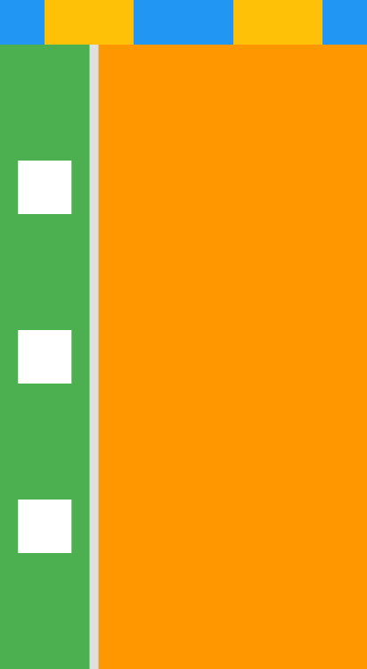
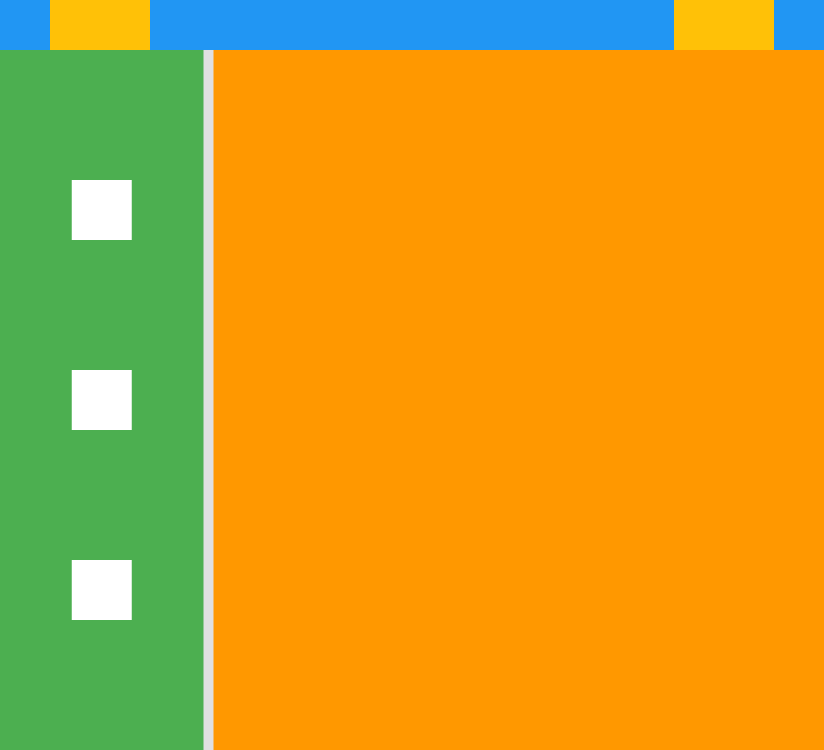

# Flutter Exam – Layout Exercise

## Goal
Build the layout below with Flutter widgets.
Write your code only where you see `// YOUR CODE` in the start code.

## Layout

```
|<-50->|<-100->|                         |<-100->|<-50->|
+------+-------+-------------------------+-------+------+  ^
| BLUE |YELLOW |          BLUE           |YELLOW | BLUE |  | 50
+------+-------+-------------------------+-------+------+  v
|      GREEN       |  |                                 |  ^
|    (25% width)   |  |         ORANGE (75% width)      |  |
|                  |  |                                 |  |
|     +------+     |  |                                 |  |
|     |WHITE | 60  |  |                                 |  |
|     +------+     |  |                                 |  |
|        60        |  |                                 |  |
|                  |  |                                 |  |
|     +------+     |  |                                 |  | remaining
|     |WHITE |     |  |                                 |  | height
|     +------+     |  |                                 |  |
|                  |  |                                 |  |
|     +------+     |  |                                 |  |
|     |WHITE |     |  |                                 |  |
|     +------+     |  |                                 |  |
|                  |  |                                 |  |
+------------------+--+---------------------------------+  v
                   <-> 10 (grey gap)
```

## Expected rendering



Example on a 412 x 750 screen.



Same view on a wider screen (824 x 750). The fixed sizes stay the same on any screen; the flexible areas adapt.

## Rules
- The root widget of `body` must be a `Column` (already in the start code)
- Do **not** use fixed widths for green and orange: the layout must adapt to any screen size
- Do not change the code outside `// YOUR CODE`

## Start code

```dart
import 'package:flutter/material.dart';

void main() {
  runApp(
    MaterialApp(
      debugShowCheckedModeBanner: false,
      home: Scaffold(
        backgroundColor: Colors.grey[300],
        body:
            // YOUR CODE
            Column(),
      ),
    ),
  );
}
```
