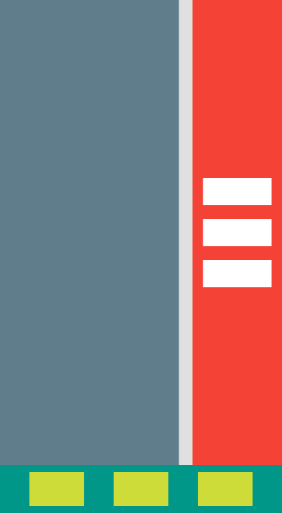
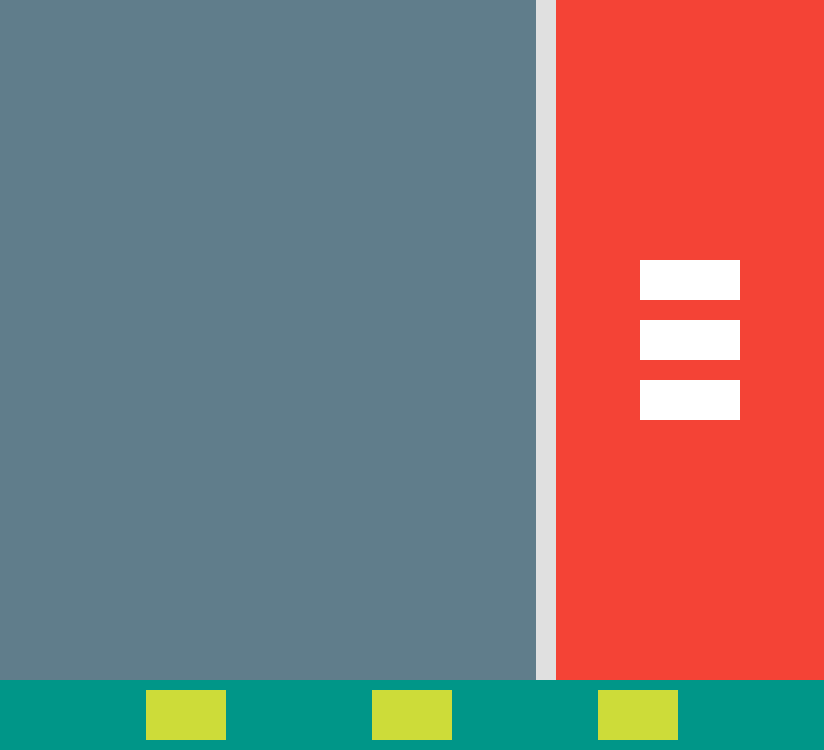

# Flutter Exam – Layout Exercise

## Goal
Build the layout below with Flutter widgets.
Write your code only where you see `// YOUR CODE` in the start code.

## Situation
You are building the skeleton of a **photo gallery**: the selected photo on the left, a panel of thumbnails on the right, and a tab bar at the bottom of the screen.
All the elements are simple colored boxes: no text, no icons.

## Layout

```
+---------------------------------+--+-----------------+  ^
|                                 |  |                 |  |
|                                 |  | RED (1/3 width) |  |
|                                 |  |                 |  |
|                                 |  |                 |  |
|                                 |  |                 |  |
|                                 |  |                 |  |
|                                 |  |   +---------+   |  |
|      BLUE GREY (2/3 width)      |  |   |  WHITE  |40 |  |
|                                 |  |   +---------+   |  |
|                                 |  |      <-100->    |  |
|                                 |  |        20       |  | remaining
|                                 |  |   +---------+   |  | height
|                                 |  |   |  WHITE  |   |  |
|                                 |  |   +---------+   |  |
|                                 |  |        20       |  |
|                                 |  |   +---------+   |  |
|                                 |  |   |  WHITE  |   |  |
|                                 |  |   +---------+   |  |
|                                 |  |                 |  |
|                                 |  |                 |  |
|                                 |  |                 |  |
|                                 |  |                 |  v
+---------------------------------+--+-----------------+  ^
|            TEAL (10 above the lime boxes)            |  |
|      +--------+      +--------+      +--------+      |  |
|      |  LIME  |      |  LIME  |      |  LIME  |      |  | 70
|      | 80x50  |      | 80x50  |      | 80x50  |      |  |
|      +--------+      +--------+      +--------+      |  |
|              (10 below the lime boxes)               |  |
+------------------------------------------------------+  v
                                  <--> 20 (grey gap)
```

Note: there is **no** gap between the main area and the bottom bar. The lime boxes are 80 wide and 50 high.

## Expected rendering



Example on a 412 x 750 screen.



Same view on a wider screen (824 x 750). The fixed sizes stay the same on any screen; the flexible areas adapt.

## Rules
- The root widget of `body` must be a `Column` (already in the start code)
- Do **not** use fixed widths for blue grey and red: the layout must adapt to any screen size
- Do not change the code outside `// YOUR CODE`

## Start code

```dart
import 'package:flutter/material.dart';

void main() {
  runApp(
    MaterialApp(
      debugShowCheckedModeBanner: false,
      home: Scaffold(
        backgroundColor: Colors.grey[300],
        body:
            // YOUR CODE
            Column(),
      ),
    ),
  );
}
```
