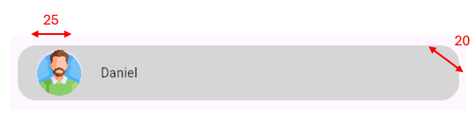
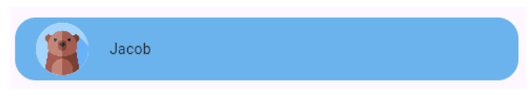
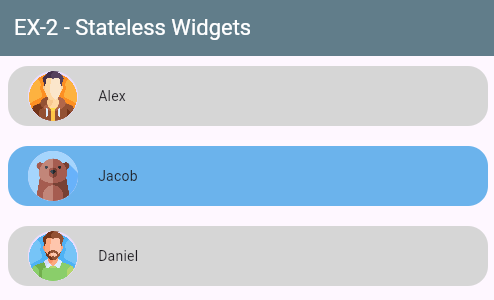

# W7 - Practice Test

In this exercise, build a stateless `MemberCard` widget.

## Member card

A `MemberCard` is composed of a circular avatar showing the member's profile image and text showing the member's name. The example below shows the dimensions and spacing of an unselected card:



A member card can also be selected. When selected, its background is blue:



## Members

A member is defined with an enum because there are only six different members. Each member has a name and an avatar image:

```dart
enum Member {
  alex(name: "Alex", imagePath: 'assets/avatars/Alex.png'),
  daniel(name: "Daniel", imagePath: 'assets/avatars/Daniel.png'),
  ethan(name: "Ethan", imagePath: 'assets/avatars/Ethan.png'),
  jacob(name: "Jacob", imagePath: 'assets/avatars/Jacob.png'),
  noah(name: "Noah", imagePath: 'assets/avatars/Noah.png'),
  mia(name: "Mia", imagePath: 'assets/avatars/Mia.png');

  const Member({required this.name, required this.imagePath});

  final String name;
  final String imagePath;
}
```

The avatar images are provided in `assets/avatars/`.

## `MemberCard` parameters

| Parameter | Type | Required |
|---|---|---|
| `member` | `Member` | Yes |
| `isSelected` | `bool` | No; defaults to `false` |

## Main screen

The main screen shall display a list of `MemberCard` widgets for different members and selection states. The mockup below shows an example:



## Displaying avatars

Use `CircleAvatar` with an `AssetImage` to display an avatar in Flutter:

```dart
CircleAvatar(
  radius: 25,
  backgroundImage: AssetImage(imagePath),
)
```
