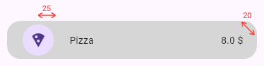
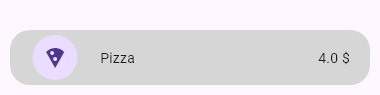
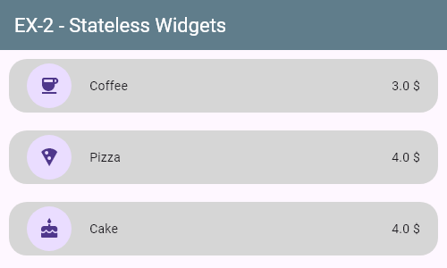

# W7 - Practice Test (G2)

In this exercise, build a stateless `ProductCard` widget.

## Product card

A `ProductCard` is composed of a circular avatar showing the product's icon, text showing the product's name, and text showing the product's price on the right. The example below shows the dimensions and spacing of a card that is not on sale:



A product card can also be on sale. When on sale, the displayed price is **half** of the product's price (here, Pizza costs `8.0 $`, so it shows `4.0 $`):



## Products

A product is defined with an enum because there are only six different products. Each product has a name, an icon, and a price:

```dart
enum Product {
  coffee(name: "Coffee", icon: Icons.coffee, price: 3.0),
  cake(name: "Cake", icon: Icons.cake, price: 4.0),
  pizza(name: "Pizza", icon: Icons.local_pizza, price: 8.0),
  icecream(name: "Ice cream", icon: Icons.icecream, price: 2.0),
  burger(name: "Burger", icon: Icons.lunch_dining, price: 6.0),
  juice(name: "Juice", icon: Icons.local_drink, price: 2.5);

  const Product({required this.name, required this.icon, required this.price});

  final String name;
  final IconData icon;
  final double price;
}
```

The icons are Flutter's built-in Material icons (`Icons.…`): no image files are needed.

## `ProductCard` parameters

| Parameter | Type | Required |
|---|---|---|
| `product` | `Product` | Yes |
| `isOnSale` | `bool` | No; defaults to `false` |

## Main screen

The main screen shall display a list of `ProductCard` widgets for different products and sale states. The mockup below shows an example:



## Displaying icons in a circle

Use `CircleAvatar` with an `Icon` to display a product icon in Flutter:

```dart
CircleAvatar(
  radius: 25,
  child: Icon(Product.coffee.icon),
)
```

## Displaying the price

The price is displayed followed by ` $`, for example:

```dart
Text("${Product.coffee.price} \$")   // shows: 3.0 $
```
