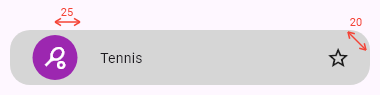
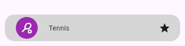
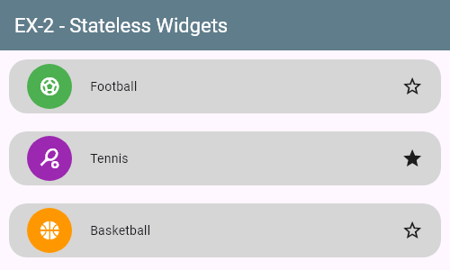

# W7 - Practice Test (G3)

In this exercise, build a stateless `SportCard` widget.

## Sport card

A `SportCard` is composed of a circular avatar showing the sport's icon on the sport's color, text showing the sport's name, and a star icon on the right. The example below shows the dimensions and spacing of a card that is not a favorite:



A sport card can also be a favorite. When it is a favorite, the star is **filled** (`Icons.star`); otherwise it is **empty** (`Icons.star_border`):



## Sports

A sport is defined with an enum because there are only six different sports. Each sport has a name, an icon, and a color:

```dart
enum Sport {
  football(name: "Football", icon: Icons.sports_soccer, color: Colors.green),
  basketball(name: "Basketball", icon: Icons.sports_basketball, color: Colors.orange),
  tennis(name: "Tennis", icon: Icons.sports_tennis, color: Colors.purple),
  volleyball(name: "Volleyball", icon: Icons.sports_volleyball, color: Colors.blue),
  rugby(name: "Rugby", icon: Icons.sports_rugby, color: Colors.brown),
  golf(name: "Golf", icon: Icons.sports_golf, color: Colors.teal);

  const Sport({required this.name, required this.icon, required this.color});

  final String name;
  final IconData icon;
  final Color color;
}
```

The icons are Flutter's built-in Material icons (`Icons.…`): no image files are needed.

## `SportCard` parameters

| Parameter | Type | Required |
|---|---|---|
| `sport` | `Sport` | Yes |
| `isFavorite` | `bool` | No; defaults to `false` |

## Main screen

The main screen shall display a list of `SportCard` widgets for different sports and favorite states. The mockup below shows an example:



## Displaying icons in a circle

Use `CircleAvatar` with an `Icon` to display a sport icon on the sport's color in Flutter:

```dart
CircleAvatar(
  radius: 25,
  backgroundColor: Sport.football.color,
  child: Icon(Sport.football.icon, color: Colors.white),
)
```
